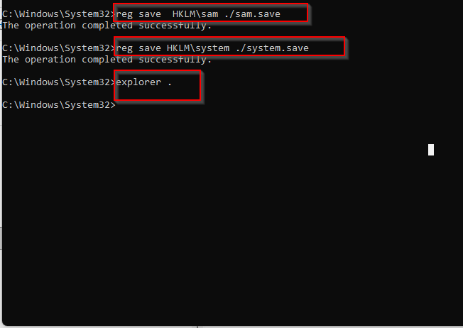
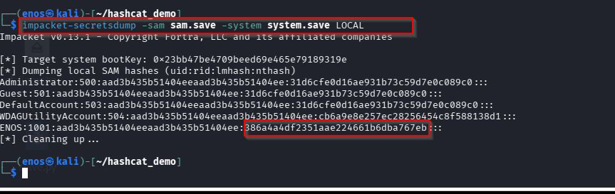
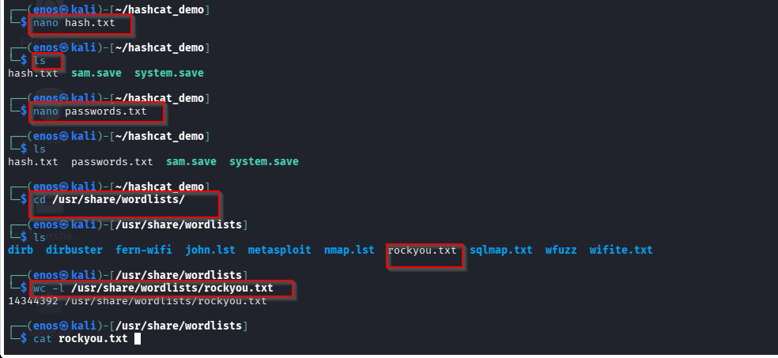
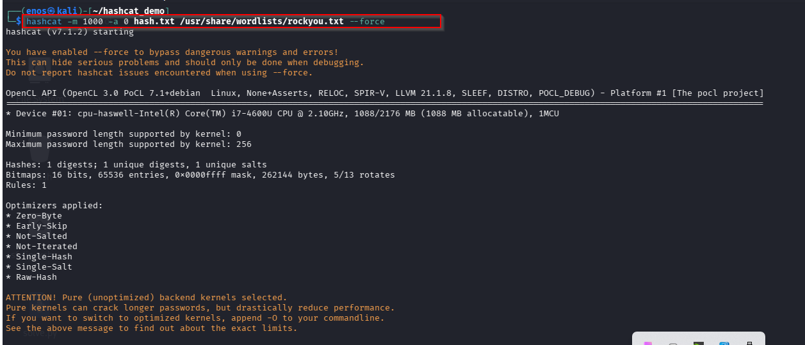
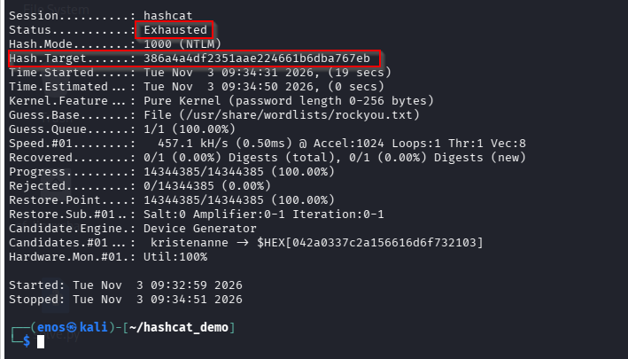
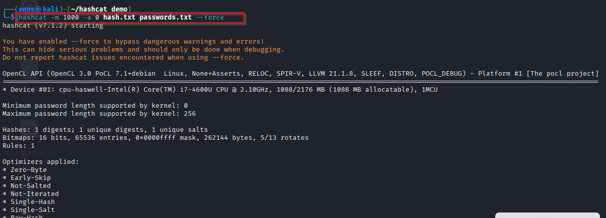
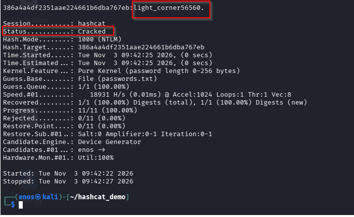
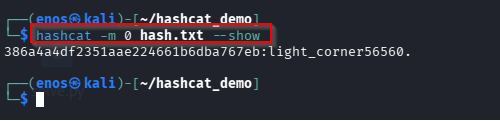

# Hashcat: Windows Password Hash Auditing

A hands-on walkthrough of the full local-password-recovery pipeline on Windows: acquiring the SAM/SYSTEM registry hives, extracting the NTLM hash with Impacket's `secretsdump.py`, and cracking it with Hashcat — first with a large generic wordlist, then with a smaller targeted one.

> Performed against my own lab machine (Windows target + Kali Linux attacker/analysis box) as a cybersecurity practical. Shown here for authorized auditing, digital forensics, and educational purposes only — this pipeline requires local administrative access to the target.

**Tools used:** `reg save`, `impacket-secretsdump`, `hashcat`

## 1. What Hashcat does

Hashcat is often described as the world's fastest password cracker. It doesn't "decrypt" a password hash — hashes are one-way. Instead it guesses candidate passwords, hashes each guess the same way the original was hashed, and checks for a match. That makes it useful both for attackers trying to break into systems and for defenders auditing how strong their own passwords really are.

It was created by Jens "atom" Steube and first released in 2009 as a CPU-only cracker. A GPU-accelerated sibling, oclHashcat, followed in 2010, exploiting a GPU's parallel processing to try billions of guesses per second instead of millions. The CPU and GPU versions merged into a single tool, Hashcat v3.00, in 2015-2016. It's free, open-source, and actively maintained.

## 2. Setup

- A Linux (or Windows/macOS) machine with an OpenCL or CUDA runtime so Hashcat can talk to the CPU/GPU
- Disk space for wordlists (`rockyou.txt` alone is roughly 134 MB / 14+ million entries)
- For the hash-extraction stage: administrative access to the target Windows machine, and Impacket's `secretsdump.py` to parse the extracted hive files

Hashcat and Impacket both ship pre-installed on Kali Linux. If they were missing:

```bash
sudo apt update
sudo apt install hashcat
sudo apt install python3-impacket
```

Confirmed available with:

```bash
hashcat --version
impacket-secretsdump -h
```

## 3. Interface and commands

Hashcat is command-line only. General syntax:

```
hashcat -m <hash-type> -a <attack-mode> <hash-file> <wordlist-or-mask> [options]
```

| Flag | Meaning |
|---|---|
| `-m` | Hash mode — a numeric code for how the hash was generated (e.g. `1000` = NTLM, the type Windows uses for local account passwords; `0` = raw MD5) |
| `-a` | Attack mode — `0` is a straight dictionary attack: try every word in a wordlist, as-is |
| `--force` | Continue despite a detected sub-optimal setup (here, CPU through a software OpenCL layer instead of a dedicated GPU) |
| `--show` | Look up a hash in Hashcat's potfile (its cache of previously cracked hashes) and print the recovered password without re-cracking it |

`impacket-secretsdump` is a companion tool, not part of Hashcat. It parses raw Windows registry hive backups and extracts the password hashes inside them in a format Hashcat can consume:

```bash
impacket-secretsdump -sam <sam-file> -system <system-file> LOCAL
```

| Flag | Meaning |
|---|---|
| `-sam` | The backed-up SAM hive (Security Account Manager) — stores local user account hashes |
| `-system` | The backed-up SYSTEM hive — stores the encryption key ("boot key") needed to unlock the SAM hashes |
| `LOCAL` | Parse these files from disk rather than connecting to a live remote machine |

## 4. Walkthrough

Pipeline: **acquire the hives → extract the hashes with secretsdump → crack the hash with Hashcat.**

### Step 1 — Acquire the registry hives (on the Windows target)

Run from an elevated Command Prompt:



- `reg save HKLM\sam ./sam.save` makes an offline copy of the SAM hive and saves it as `sam.save`.
- `reg save HKLM\system ./system.save` does the same for the SYSTEM hive, which holds the boot key needed to unlock the SAM hashes — SAM alone can't be read without it.
- `explorer .` opens a File Explorer window at the current folder, to grab the two files and copy them off the machine for analysis on Kali.

### Step 2 — Extract the hashes with secretsdump (on Kali)

With `sam.save` and `system.save` copied into `~/hashcat_demo`:



This reads the two hive backups offline (`LOCAL` mode — no live connection to the target needed) and uses the SYSTEM hive's boot key to decrypt the SAM hive's contents, printing one line per local account as `username:uid:lmhash:nthash`. The LM hash is blank/disabled on modern Windows (`aad3b435...` is the fixed "empty" value) — the NTLM hash at the end is the real target. The account of interest here, `ENOS`, has NTLM hash `386a4a4df2351aae224661b6dba767eb`.

### Step 3 — Prepare input files and check the wordlist



```bash
nano hash.txt       # paste the NTLM hash: 386a4a4df2351aae224661b6dba767eb
nano passwords.txt  # a small custom wordlist of candidate passwords
```

`hash.txt` holds just the target hash. `passwords.txt` is a small, targeted wordlist built for this exercise, used once the generic list fails. Kali ships with `rockyou.txt`, a well-known 14.3-million-entry wordlist of real passwords from a 2009 breach — `wc -l` counts how many candidates it holds before using it.

### Step 4 — First attempt: generic wordlist (rockyou.txt)




`-m 1000` tells Hashcat the hash is NTLM; `-a 0` runs a straight dictionary attack against all 14+ million rockyou entries. The run finished with **Status: Exhausted** — every candidate was tried and none matched. The password wasn't in this generic list.

### Step 5 — Second attempt: targeted wordlist




Switching the wordlist argument to the smaller, targeted `passwords.txt` succeeded: **Status: Cracked**. The recovered password for the `ENOS` account was `light_corner56560`.

### Step 6 — Confirm the result



`--show` doesn't crack anything — it looks the hash up in Hashcat's potfile and prints the stored `hash:password` pair, confirming the result without re-running the attack.

## 5. Results and interpretation

**Hash format** (`uid:rid:lmhash:nthash`): secretsdump's output lists each local account's username, relative ID, LM hash and NTLM hash. The repeated `aad3b435b51404eeaad3b435b51404ee` LM-hash value across accounts isn't a coincidence — it's the fixed value Windows stores when the (obsolete, weak) LM hash is disabled, the default on modern systems. The NTLM hash is the real target.

**Exhausted vs. Cracked:** Hashcat's two end states for an attack. *Exhausted* means the whole candidate list was tried with no match. *Cracked* means a match was found and Hashcat reports the recovered plaintext.

**Why the targeted list worked where rockyou failed:** `light_corner56560` is a long (17-character), unusual password with no dictionary meaning, so it was never likely to appear in a leaked-password list. It only appeared here because it was deliberately placed in the smaller, purpose-built `passwords.txt` — a reminder that a huge generic wordlist is no guarantee of success, and real attacks (or audits) often need to be tailored to the target.

**Speed and caching:** Hashcat reported a modest hash rate (tens of thousands of hashes/second) because it ran on a CPU through a software OpenCL layer rather than a dedicated GPU; a real GPU would be orders of magnitude faster. Once cracked, the result was stored in the potfile, so `--show` could re-display it instantly without rerunning the attack.

## 6. Cybersecurity and forensic applications

- **Digital forensics:** investigators with a legally acquired disk image or registry hives from a seized machine use this same hive-to-hash-to-password pipeline to recover account passwords as evidence, or to unlock other encrypted artifacts protected by the same credentials.
- **Password auditing / defensive security:** organizations run their own password hashes through Hashcat (with permission) to find weak, reused or predictable passwords before an attacker does, then enforce stronger policies.
- **Penetration testing and red teaming:** after an authorized tester gains limited access to a system, dumping and cracking local hashes is a standard technique for privilege escalation or lateral movement.
- **Incident response:** after a breach, responders may crack recovered hashes to understand which accounts and passwords were compromised and how reused credentials might expose other systems.
- **Law enforcement:** cracking is used, under warrant, to access password-protected evidence relevant to an investigation.

## 7. Advantages and limitations

| Advantages | Limitations |
|---|---|
| Extremely fast when GPU-accelerated — billions of guesses/second | Can only recover a password actually reachable by its wordlist, rules or mask — a genuinely random, long password may never be found, as the rockyou attempt here demonstrated |
| Supports hundreds of hash types (NTLM, MD5, SHA-family, bcrypt, WPA/WPA2, document and disk encryption, and more) | Performance depends heavily on hardware — without a GPU, cracking is far slower |
| Multiple attack modes (dictionary, mask/brute-force, hybrid, combinator) suit different situations | `--force` bypasses Hashcat's own safety warnings, which can mask real configuration problems |
| Free, open-source, cross-platform, actively developed | Raises legal and ethical concerns, since the same technique that audits a system can attack one without authorization |
| `--show` and the potfile mean cracked results are never lost or recomputed unnecessarily | |

## 8. Challenges and solutions

**Challenge 1:** the generic `rockyou.txt` wordlist failed to crack the hash (Exhausted).
**Solution:** switched to a smaller, custom wordlist built around plausible candidate passwords for the target account, which succeeded — reinforcing that targeted, context-aware wordlists often outperform sheer list size.

**Challenge 2:** the lab machine had no dedicated GPU, so Hashcat fell back to a CPU-based OpenCL runtime, much slower, triggering Hashcat's performance warning.
**Solution:** used `--force` to proceed anyway, since this was a small, controlled lab rather than a real engagement where speed is critical.

## 9. Conclusion

This exercise walked through the full lifecycle of recovering a Windows account password from scratch: acquiring the SAM and SYSTEM registry hives from a target machine, using Impacket's `secretsdump` to extract the NTLM hash offline, and using Hashcat to attack that hash — first unsuccessfully with a large generic wordlist, then successfully with a smaller, targeted one.

Key takeaways: hash cracking is a multi-tool pipeline rather than a single command; wordlist quality and relevance matter more than raw size; and the same skills used here for a learning lab are the ones real forensic investigators, auditors and penetration testers rely on — always within clear legal and ethical boundaries.
